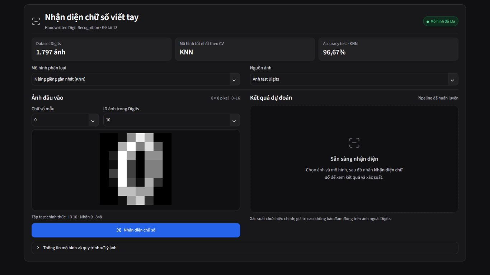
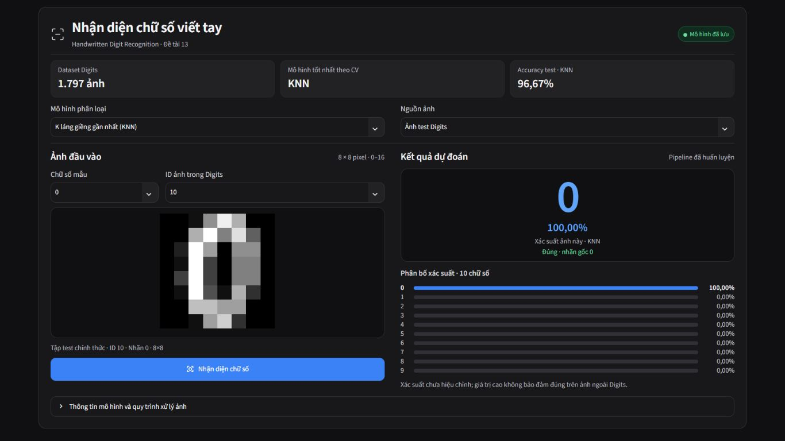
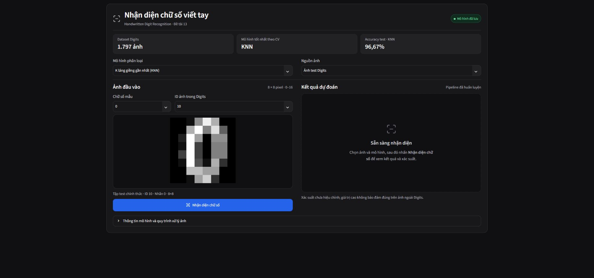
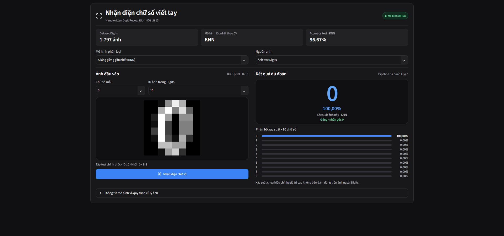

# Responsive Layout Review — zoom 100%

Đã reset Ctrl+0 và đo window.innerWidth/innerHeight. CSS zoom=1, transform=none, visualViewport.scale=1, devicePixelRatio≈1. Không dùng full-page screenshot để kết luận vừa màn hình. Các ảnh bên dưới chụp fullPage=false; kích thước JPEG thực được ghi trong verification.json vì công cụ có thể giới hạn ảnh màn hình lớn.

## Kết quả đo

| Viewport thực tế | document scrollHeight (đóng) | stMain scrollHeight (đóng) | Tràn dọc | Tràn ngang | stMain khi mở kỹ thuật |
|---|---:|---:|---:|---|---:|
|1920x1080|1080|1080|0 px|Không|1135|
|1920x900|900|900|0 px|Không|1135|
|1536x864|864|864|0 px|Không|1135|
|1366x768|768|768|0 px|Không|1106|
|1280x720|720|720|0 px|Không|1079|

45 phép đo: 40 trạng thái đóng technical không tràn; 5 trạng thái mở technical cuộn tự nhiên. Mỗi viewport kiểm empty, dự đoán test, đổi model, đổi chữ số/ID, dự đoán mới, mở/đóng technical, preview upload và dự đoán upload. Đổi lựa chọn xóa kết quả cũ; ID21 được chọn từ đúng danh sách lớp1/test. Các dự đoán test trong trình duyệt khớp CSV canonical.

Giữ typography: header25–26px, section17px, số dự đoán80–88px; không thu nhỏ toàn bộ chữ. Max-width1280px, padding khung20px. ID selectbox ở trong cột ảnh; ảnh Digits200–212px, nearest-neighbor. Reset margin âm của Markdown để không chồng chữ. Không giấu phần tràn bằng CSS.

## Bằng chứng kiểm thử

- [Unittest: 40/40 PASS, 14.551 s](tests_final.log). Chỉ thay API test tương ứng slider→selectbox, giữ assertion option/cả ba Pipeline.
- [Ma trận số đo gốc](browser_matrix.json); [kiểm tra tự động](verification.json); [chẩn đoán trong quá trình sửa](layout_diagnostics.json).
- [61 checksum trước](protected_before.json)/[sau](protected_after.json) khớp; gồm notebook và toàn bộ model/registry/outputs chính thức. Chín hàm ngoài main không đổi AST. Không fit/tuning hoặc thêm dependency.
- Upload/lỗi dùng harness tạm import app.main, render widget native, cấp bytes fixture qua mock; không kiểm lại hộp chọn file OS trong lượt này. Harness được reload module để không đo CSS cũ trong cache. Fixture ngoài vẫn dự đoán sai như trước, không chỉnh thuật toán để thay kết quả. Native upload đã được thao tác thực ở lượt UI Redesign trước.

## Ảnh viewport — chưa dự đoán và đã dự đoán

| Viewport | Chưa dự đoán | Đã dự đoán |
|---|---|---|
|1920x1080|[Empty](empty_1920x1080.jpg)|[Prediction](prediction_1920x1080.jpg)|
|1920x900|[Empty](empty_1920x900.jpg)|[Prediction](prediction_1920x900.jpg)|
|1536x864|[Empty](empty_1536x864.jpg)|[Prediction](prediction_1536x864.jpg)|
|1366x768|[Empty](empty_1366x768.jpg)|[Prediction](prediction_1366x768.jpg)|
|1280x720|[Empty](empty_1280x720.jpg)|[Prediction](prediction_1280x720.jpg)|

## Các trạng thái khác

- Đổi mô hình: [1366x768](model_changed_1366x768.jpg), [1920x900](model_changed_1920x900.jpg), [1280x720](model_changed_1280x720.jpg)
- Đổi chữ số và ID: [1366x768](digit_id_changed_1366x768.jpg), [1920x900](digit_id_changed_1920x900.jpg), [1280x720](digit_id_changed_1280x720.jpg)
- Dự đoán sau thay đổi: [1366x768](changed_input_prediction_1366x768.jpg), [1920x900](changed_input_prediction_1920x900.jpg), [1280x720](changed_input_prediction_1280x720.jpg)
- Upload preview — fixture: [1366x768](upload_preview_1366x768.jpg), [1920x900](upload_preview_1920x900.jpg), [1280x720](upload_preview_1280x720.jpg)
- Upload prediction — fixture: [1366x768](upload_prediction_1366x768.jpg), [1920x900](upload_prediction_1920x900.jpg), [1280x720](upload_prediction_1280x720.jpg)
- Mở kỹ thuật — cuộn tự nhiên: [1366x768](technical_open_1366x768.jpg), [1920x900](technical_open_1920x900.jpg), [1280x720](technical_open_1280x720.jpg)

## 1366×768 — zoom100%

## 1920×900 — zoom100%

