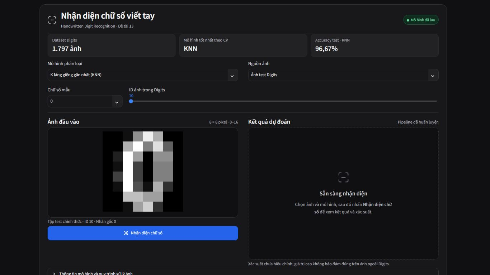
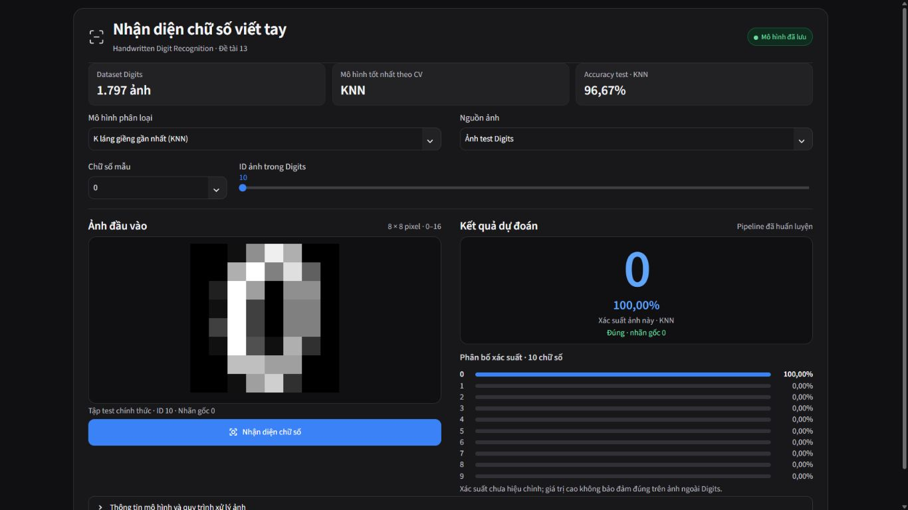
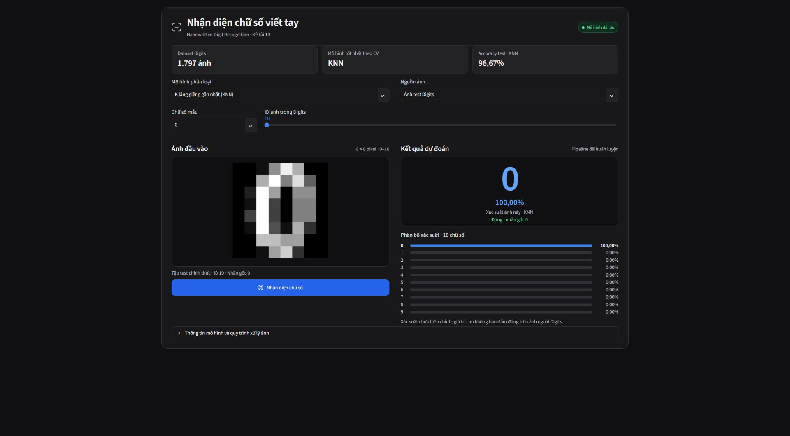
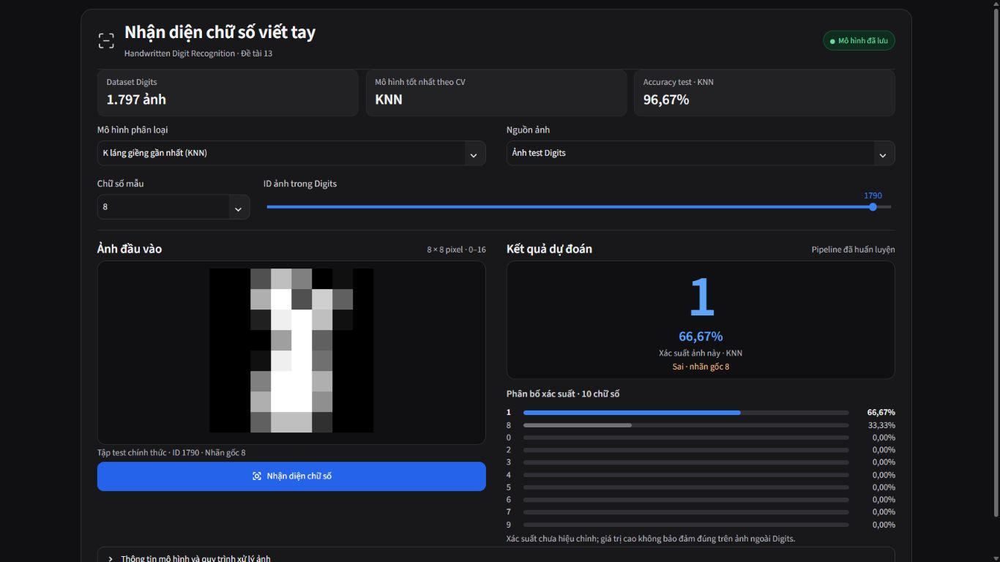
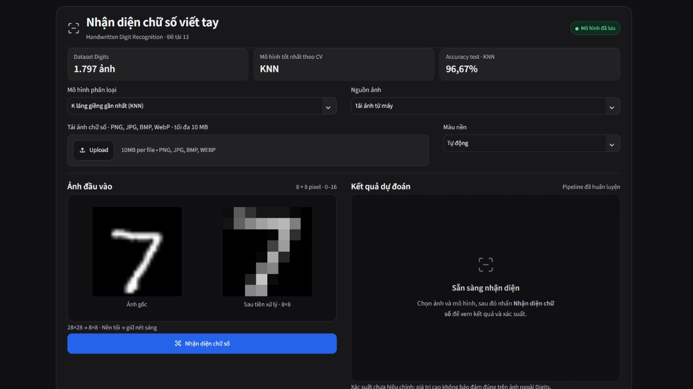
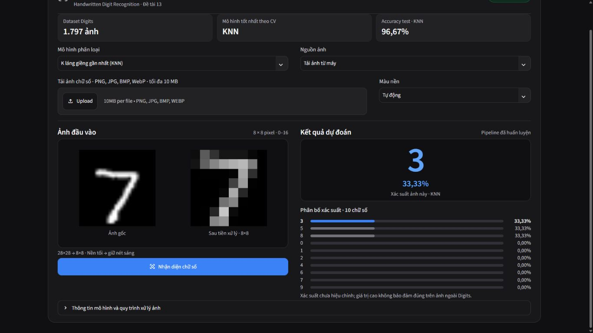
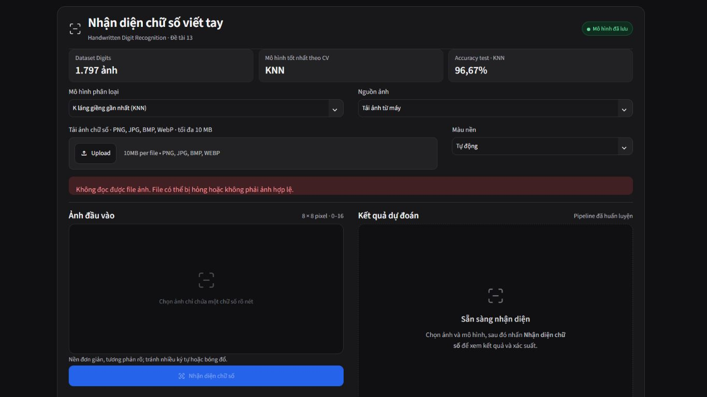

# Final UI Polish — ảnh kiểm tra

Giữ thiết kế và dữ liệu thật. Upload/lỗi dùng harness tạm nhập app.main, render widget native và cung cấp bytes fixture qua mock; không thử lại hộp chọn file OS trong lượt này. Xem polish_checks.json cho kích thước JPEG thực, viewport và bằng chứng kiểm thử.

## Chưa dự đoán — ứng dụng thật

## Dự đoán đúng — ứng dụng thật

## Desktop lớn — ứng dụng thật

## Dự đoán sai — ứng dụng thật

## Upload preview — harness dùng fixture

## Upload kết quả — harness dùng fixture

## File lỗi — harness dùng fixture

